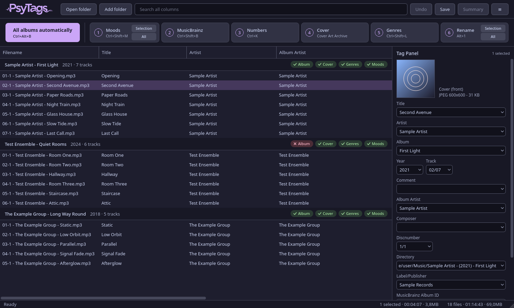

# PsyTags

PsyTags is a tag editor for music collections. It runs on Windows and Linux, and its interface is available in English and German.

The main window has a file list and a tag panel. One command tags every loaded album, and each step can also be run on its own. Moods are determined locally from the audio.

PsyTags is still in development. There are no releases yet.



## Before you start

PsyTags writes to your music files and renames them. Try it on copies of a few albums first.

Undo (Ctrl+Z) reverts tag changes and renames while the program is running. Deleted files always go to the recycle bin.

## Usage

1. Open a folder (Ctrl+D).
2. Run **All albums automatically** (Ctrl+Alt+B).
3. Check the summary and finish whatever stayed open.
4. Rename the files with **All** in the Rename step. **Selection** (Alt+1) renames only the selected files.

F1 opens the help, which covers every feature.

## The automatic run

For each album in the list, in this order:

| Step | Result |
|---|---|
| Moods | Each song is analyzed and the MOOD field is written. |
| MusicBrainz | The matching release is looked up and the tags are written. If it stays open and a token is set, Discogs is asked. |
| Numbers | Track and disc numbers are written. |
| Cover | The enabled cover sources are asked in order. |
| Genres | Genres are fetched from Last.fm. |

An album is only tagged when the match is certain. A release must have a file for every track, matched by title. Otherwise the album stays unchanged apart from its moods, and the summary lists it as open.

## Moods

The analysis uses two models of about 20 MB, downloaded on first use. No audio leaves your computer. The result is written to MOOD and no later step overwrites it. Options lets you choose between few, normal and many moods per song.

## Services

| Service | Used for | Setup |
|---|---|---|
| MusicBrainz | Tags | None |
| Cover Art Archive | Covers | None |
| Discogs | Second source for albums MusicBrainz leaves open, text only | Free personal token |
| Last.fm | Genres | Free API key |

More cover sources can be added as plugins. The help describes the format.

## Supported formats

AAC, AIFF, APE, DSF, FLAC, M4A, M4B, MP2, MP3, MP4, MPC, OGG, Opus, Speex, TAK, TTA, WAV, WMA, WavPack

## Running from source

Requires Python 3.11 or newer and, for the mood analysis, ffmpeg.

```
git clone https://github.com/Psychotoxical/PsyTags.git
cd PsyTags
python -m venv .venv
.venv/bin/pip install .
.venv/bin/psytags [folder ...]
```

On Windows the scripts are in `.venv\Scripts`.

## Tests

```
pip install -e .
QT_QPA_PLATFORM=offscreen python -m unittest discover -s tests
```

## License

PsyTags is licensed under GPL-3.0-or-later.

The mood models are not part of this repository. They come from the Music Technology Group at Universitat Pompeu Fabra and are licensed under CC BY-NC-SA 4.0. The Last.fm terms allow non-commercial use only. The in-app About window lists all libraries and services with their licenses.
