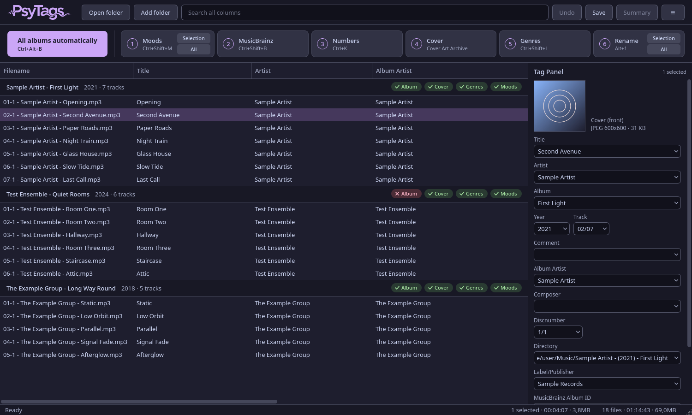

<!-- psy-suite:start -->
<p align="center"><sub>Part of the <b>Psy Suite</b></sub></p>
<table align="center">
  <tr>
    <td align="center" valign="top" width="33%">
      <a href="https://github.com/Psysonic/psysonic"><picture><source media="(prefers-color-scheme: dark)" srcset="https://raw.githubusercontent.com/Psysonic/psysonic/main/.github/psy-suite/psysonic-dark.svg"></picture></a><br>
      <sub>Desktop music player for Navidrome and Subsonic</sub>
    </td>
    <td align="center" valign="top" width="33%">
      <a href="https://github.com/Psysonic/psysonic-mobile"><picture><source media="(prefers-color-scheme: dark)" srcset="https://raw.githubusercontent.com/Psysonic/psysonic-mobile/main/.github/psy-suite/psysonic-mobile-dark.svg"></picture></a><br>
      <sub>Psysonic on iPhone, iPad and Android (beta)</sub>
    </td>
    <td align="center" valign="top" width="33%">
      <a href="https://github.com/Psysonic/PsyAudio"><picture><source media="(prefers-color-scheme: dark)" srcset="https://raw.githubusercontent.com/Psysonic/PsyAudio/main/.github/psy-suite/psyaudio-dark.svg"></picture></a><br>
      <sub>Bit-perfect CD ripper and audio converter</sub>
    </td>
  </tr>
</table>
<!-- psy-suite:end -->

# PsyTags

PsyTags is a tag editor for music collections. It runs on Windows, Linux and macOS, and its interface is available in English and German.

The main window has a file list and a tag panel. One command tags every loaded album, and each step can also be run on its own. Moods are determined locally from the audio.

PsyTags is young. Downloads for Windows, Linux and macOS are on the [Releases](https://github.com/Psysonic/PsyTags/releases) page.



## Why PsyTags

For about 25 years Mp3tag by Florian Heidenreich has been one of the programs I use most. What I came to miss was automation for a large collection. PsyTags is built for my own workflow first: it does as much as possible on its own, and the final check stays as simple and clear as in Mp3tag, which inspired it. I am grateful for those years and for that inspiration.

PsyTags is an independent project and is not affiliated with or endorsed by Mp3tag or its author.

## Before you start

PsyTags writes to your music files and renames them. Try it on copies of a few albums first.

Undo (Ctrl+Z, on a Mac ⌘Z) reverts tag changes and renames while the program is running. Deleted files always go to the recycle bin.

## Usage

1. Open a folder (Ctrl+D).
2. Run **All albums automatically** (Ctrl+Alt+B).
3. Check the summary and finish whatever stayed open.
4. Rename the files with **All** in the Rename step. **Selection** (Alt+1) renames only the selected files.

F1 opens the help, which covers every feature.

On a Mac, Ctrl is the Command key (⌘) and Alt the Option key (⌥); the step bar and the help show the Mac symbols. Showing the Tag Panel, adding a folder and switching between panel, search and list use the Control key there (⌃Q, ⌃H, ⌃⇥), since macOS keeps ⌘Q, ⌘H and ⌘⇥ for itself.

## The automatic run

For each album in the list, in this order:

| Step | Result |
|---|---|
| Moods | Each song is analyzed and the MOOD field is written. |
| MusicBrainz | The matching release is looked up and the tags are written. If it stays open, Discogs and then Beatport are asked, as far as they are set up. |
| Numbers | Track and disc numbers are written. |
| Cover | The enabled cover sources are asked in order. |
| Genres | Genres are fetched from Last.fm. |

An album is only tagged when the match is certain. A release must have a file for every track, matched by title. Otherwise the album stays unchanged apart from its moods, and the summary lists it as open.

## Moods

The analysis uses two models of about 20 MB, downloaded on first use. No audio leaves your computer. The result is written to MOOD and no later step overwrites it. Options lets you choose between few, normal and many moods per song.

## Services

| Service | Used for | Setup |
|---|---|---|
| MusicBrainz | Tags | None |
| Cover Art Archive | Covers | None |
| Discogs | Second source for albums MusicBrainz leaves open, text only | Free personal token |
| Beatport | Third source for open albums, with BPM and key; covers | Own API access, granted by Beatport only on request |
| Last.fm | Genres | None, the release packages bring a key. Builds from source need their own (Last.fm Pro) |

More cover sources can be added as plugins. The help describes the format.

## Supported formats

AAC, AIFF, APE, DSF, FLAC, M4A, M4B, MP2, MP3, MP4, MPC, OGG, Opus, Speex, TAK, TTA, WAV, WMA, WavPack

## Installation

Download from the [Releases](https://github.com/Psysonic/PsyTags/releases) page:

- **Windows 10 and 11:** `PsyTags-Setup-<version>.exe`. It installs for your user without admin rights; the first page also offers an installation for all users. Your settings stay when you uninstall. The installer and the app are signed.
- **Debian, Ubuntu, Mint:** `psytags_<version>_amd64.deb`, installed with `sudo apt install ./psytags_<version>_amd64.deb`.
- **Fedora, openSUSE:** `psytags-<version>-1.x86_64.rpm`, installed with `sudo dnf install ./psytags-<version>-1.x86_64.rpm` or `sudo zypper install`.
- **Other Linux:** `PsyTags-<version>-x86_64.AppImage`. Make it executable (`chmod +x`) and start it.
- **macOS 13 or newer:** `PsyTags-<version>-macOS-arm64.dmg` for Apple Silicon (M1 and later), `PsyTags-<version>-macOS-x86_64.dmg` for Intel. Open it and drag PsyTags into Applications. The app is signed and notarized by Apple.

All of them come with ffmpeg for the mood analysis.

## Running from source

Requires Python 3.11 or newer and, for the mood analysis, ffmpeg.

```
git clone https://github.com/Psysonic/PsyTags.git
cd PsyTags
python -m venv .venv
.venv/bin/pip install .
.venv/bin/psytags [folder ...]
```

On Windows the scripts are in `.venv\Scripts`.

## Tests

```
pip install -e .
QT_QPA_PLATFORM=offscreen python -m unittest discover -s tests
ruff check .
```

Changes go to `main` through pull requests only; [CONTRIBUTING.md](CONTRIBUTING.md) has the house rules. Every pull request runs the tests, Ruff, ShellCheck and actionlint on Linux. Building a release runs the tests on Windows and macOS (Intel and Apple Silicon) as well and builds all packages; the Linux packages are test-installed on Ubuntu and Fedora, the Mac apps are signed, notarized and checked by Gatekeeper.

## Translating PsyTags

PsyTags speaks English, German, Spanish, French, Norwegian Bokmål, Dutch, Romanian, Russian, Chinese, Japanese, Hungarian, Polish, Bulgarian, Italian, Ukrainian and Greek. It follows the system language until another one is chosen under Options → Program.

Every language other than German and English is one file in [`psytags/resources/locales/`](psytags/resources/locales): the English text on the left, the translation on the right.

```json
{
  "Save tag": "Guardar etiqueta",
  "Step {1} of {2}": "Paso {1} de {2}",
  "{1} files": { "one": "{1} archivo", "other": "{1} archivos" }
}
```

- **Improve a language:** change the text on the right and open a pull request. Keep everything in `{…}` as it is; PsyTags puts numbers and names there. A `&` marks the key of a menu entry; keep exactly one.
- **Counts** can be objects with one form per plural category of the language ([CLDR plural rules](https://www.unicode.org/cldr/charts/latest/supplemental/language_plural_rules.html)): `one` and `other` for most languages, `one`, `few`, `many` and `other` for Russian, Ukrainian and Polish, `one`, `few` and `other` for Romanian, only `other` for Chinese and Japanese.
- **What is missing:** `python packaging/i18n_report.py` shows how complete every language is; `python packaging/i18n_report.py fr` lists the missing texts of one language. A missing or empty text shows in English.
- **A new language:** `python packaging/i18n_report.py --new <code>` writes a file with every English text, ready to translate. Add the code and the language's own name to `LANGUAGES` in `psytags/i18n.py`; if its plural rules differ from English, add them to `plural_form` there.
- `python -m unittest tests.test_locales` checks the files: unknown texts, placeholders, menu keys and plural forms.

The help pages are in German and English (`psytags/resources/help/<code>/`); other languages show the English help until a folder for them exists.

## Releases

A release starts with a new version number in `psytags/__init__.py` and `pyproject.toml` and its section in `CHANGELOG.md`. Once that is on `main`, the workflow creates a release draft with the section as text and the installer, AppImage, deb, rpm and both Mac disk images attached. Publishing the draft creates the tag.

## Acknowledgements

The color themes Mocha and Latte come from Catppuccin and are licensed under MIT.

## License

Copyright (C) 2026 Psychotoxical. PsyTags is licensed under GPL-3.0-or-later; the full text is in [LICENSE](LICENSE).

The mood models are not part of this repository. They come from the Music Technology Group at Universitat Pompeu Fabra and are licensed under CC BY-NC-SA 4.0. The Last.fm terms allow non-commercial use only. The in-app About window lists all libraries and services with their licenses.
